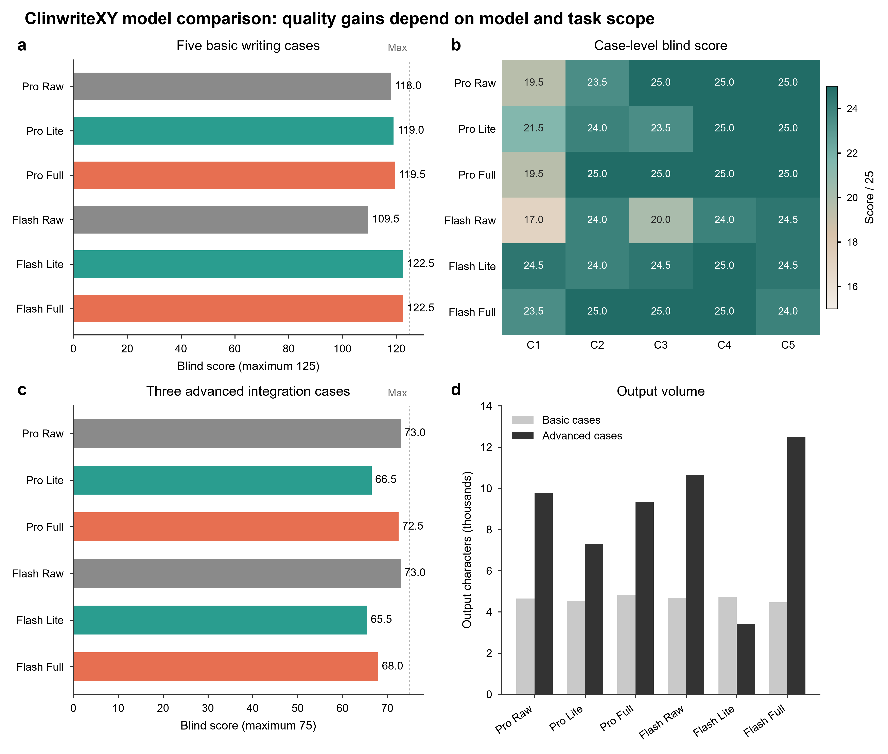

# ClinwriteXY Lite

中文优先的临床论文段落写作与证据边界检查 Skill。它处理一段摘要、结果、讨论或
结论，在改善中英文表达的同时，保住数字、分母、引用、限定词和结论强度。

> 改得像论文，也保住数字和结论边界。

## 开源版与完整版

| 开源 ClinwriteXY Lite | 完整版 ClinwriteXY |
|---|---|
| 免费，MIT License | 一次性买断，购买者个人授权 |
| 适用于一段摘要、结果、讨论、结论或摘要对齐 | 适用于整篇论文、学位论文、综述章和完整返修流程 |
| 单段证据冻结、中文微编辑、双语对齐、数字保真脚本 | 项目状态、跨文件审计、引用与报告规范、审稿回复、逐页汇报设计 |
| 不处理整篇审阅、跨文件追踪、项目恢复和成品 PPT | 覆盖临床课题从开题、执行、成稿到返修的工作流 |

Lite 是完整版能力范围的一个独立短篇入口。需要整篇论文、多文献证据综合、
跨文件结果核对、审稿回复或长期项目记录时，使用完整版。

**完整版当前状态：爱发电认证审核中。** 认证完成前，可以通过
[我的小红书主页](https://www.xiaohongshu.com/user/profile/69666bf30000000003012a27)
查看商品和私信购买。完整版源码不公开，Lite 的开源许可不改变完整版的购买者授权。

## 模型对比结果

2026-11-13 使用 5 个基础写作病例和 3 个高阶综合病例，对比 DeepSeek V4 Pro、
V4 Flash 分别搭配 Raw、ClinwriteXY Lite 和 ClinwriteXY Full 的表现。

在 5 个基础病例中：

| 条件 | 盲评均值 |
|---|---:|
| Flash Raw | 109.5 / 125 |
| **Flash + Lite** | **122.5 / 125** |
| Flash + Full | 122.5 / 125 |
| Pro Raw | 118.0 / 125 |
| Pro Lite | 119.0 / 125 |
| Pro Full | 119.5 / 125 |

Flash + Lite 和 Flash + Full 保留了关键病例中的 `1,702` 与 `851` 两个队列
样本量，Pro 三种条件和 Flash Raw 均遗漏。本轮短篇写作证据支持：

> 使用 V4 Flash + ClinwriteXY Lite，以更低成本达到接近或略高于 V4 Pro Raw
> 的盲评水平。

这个结论只适用于本轮脱敏短篇写作病例，不能外推到所有论文、真实投稿或所有临床
亚专科。完整方法、评分锚点、脱敏原文、六个组合的全部输出和科研风格图见
[模型对比实验](docs/model-comparison-20261113/README.md)。



**English summary:** ClinwriteXY Lite is a small clinical-writing skill for one
Chinese or English abstract, results, discussion, limitation, or conclusion
paragraph. It drafts from supplied facts, calibrates claims to the available
evidence, aligns bilingual abstracts, and checks whether numeric or citation
tokens changed during editing.

## 适合谁

- 正在写临床 SCI 结果、讨论、摘要或学位论文段落的硕博研究生；
- 需要把中文医学文字改得更自然，同时不能改动数字、分母和结论强度的人；
- 想把英文摘要与中文结果逐项对齐，排查样本量、终点和验证层级错位的人；
- 想在交给导师或润色机构前，先做一次短段落证据边界检查的人。

## 独特之处

Lite 把四个环节压进一个小包：

1. **先冻结证据，再改语言**：先确认研究设计、分母、效应量、验证层级和结论类型。
2. **中文临床微编辑**：处理名词堆叠、长定语、空泛评价、机械转折和翻译腔。
3. **证据到语言映射**：把关联、预测、诊断、机制和临床效用分开处理。
4. **可运行的保真检查**：脚本可发现修改前后数字和常见引用标记的增删，减少肉眼漏看。

GitHub 上已有覆盖面很广的科研写作 Skill。Lite 的定位更窄：集中处理临床论文的
单个高风险段落，并让证据边界、中文表达和机械保真检查出现在同一条工作流里。

## Why Lite

通用写作 Skill 往往能润色语言，却容易漏掉临床写作里的高风险变化：

- 把关联写成因果；
- 把内部验证写成外部验证；
- 把 AUC 写成临床获益；
- 把统计显著写成临床重要；
- 改写时丢失分母、置信区间或限定词；
- 中英文摘要的人群、终点或结论强度不一致。

Lite 把这些问题压缩在单段工作流里。它比完整版轻，但可以独立完成实际工作，不依赖
完整版的提示词。

## What it does

- 从作者提供的分析结果起草一段正文；
- 修改一段中文或英文临床论文文字；
- 检查一段话的结论是否超过现有证据；
- 对齐中英文摘要中的人群、样本量、终点、效应方向和结论强度；
- 检查修改前后数字与引用标记是否被增删。

默认范围为一中文段落不超过 800 字，或一英文段落不超过 500 words。

## What it does not do

- 不搜索实时文献，不核验 DOI 是否存在；
- 不重新运行统计分析；
- 不审阅整篇学位论文或完整投稿包；
- 不处理 Word 修订、批注、目录、页码和复杂排版；
- 不生成成品 PPT；
- 不恢复长期项目状态；
- 不代替作者、导师、统计师、伦理委员会或期刊审稿人。

需要检索、文献管理、Word 修订、图表或完整论文流程时，请另装对应工具。

## Install

### Codex

把整个 `clinwritexy-lite` 文件夹放入：

```text
%USERPROFILE%\.codex\skills\clinwritexy-lite
```

macOS 或 Linux 通常放入：

```text
~/.codex/skills/clinwritexy-lite
```

重启或新开 Codex 会话，然后直接说明任务，或显式调用：

```text
Use $clinwritexy-lite to revise this clinical results paragraph.
```

### Claude Code or another SKILL.md host

把整个目录放入宿主约定的 skills 目录。也可以把目录附加给 Agent，并要求它先读取
`SKILL.md`。不要只复制 `SKILL.md`，因为语言规则、证据边界和摘要对齐规则位于
`references/`。

只要宿主支持读取 `SKILL.md` 及目录内引用文件，就可以尝试使用。Codex 用户可以
直接安装；Claude Code、DeepSeek Harness、WorkBuddy 或其它 Agent 的具体安装目录
和触发方式，以各自当前版本的文档为准。

安装后先用一个不含患者信息的短段落测试。建议新开会话，确认模型确实读取了
`SKILL.md` 和所需 `references/`，再用于真实稿件。

## 30-second test

```text
使用 ClinwriteXY Lite 修改下面这段：

模型A的AUC为0.86，可准确预测患者预后并指导临床治疗。研究完成了内部验证，
未做外部验证，也未进行决策影响研究。

要求：保留全部数字和验证层级，不要新增引用或结果。
```

预期行为：保留 `0.86`、`内部验证` 和 `未做外部验证`，把“准确预测”和
“指导临床治疗”收回到证据能够支持的范围，并指出仍需补充校准、外部验证和临床
效用证据。

## Preservation check

安装后可运行：

```text
python scripts/check_preservation.py original.txt revised.txt
```

脚本检查数字和常见引用标记是否被增删。它只做机械诊断，不能判断引用是否真的支持
句子。发现差异后仍需人工核对上下文。

它也不能自动判断分母是否被换了研究对象、内部验证是否被写成了外部验证，或关联
是否被写成了因果。这些项目由 Skill 的审阅规则处理，仍需要作者最终确认。

运行内置测试：

```text
python -m unittest discover -s scripts -p "test_*.py"
python scripts/validate_evals.py evals/cases.jsonl
```

## Privacy

不要提交患者姓名、住院号、影像、联系方式、医院内部账号、未脱敏原始数据或受限
机构文件。使用云端模型时，材料会受所用 Agent 和模型服务的数据政策约束。公开示例
应保持合成内容。

真实稿件应先脱敏，并遵守所用 Agent、模型服务和机构的数据政策。Lite 不提供患者
诊疗建议，也不替代导师、统计师、伦理委员会或期刊审稿人。

## License

本仓库使用 MIT License。完整版 ClinwriteXY 使用独立的购买者授权，不因 Lite 开源
而改变。

## Full version

完整版面向整篇论文、学位论文、多文献证据综合、审稿回复和项目恢复，并包含：

- 中英文论文与学位论文写作、证据审计和结论校准；
- 多研究综述、临床与动物证据分层、逐句引用定位；
- 项目状态恢复、数据版本记录、跨文件结果核对；
- 审稿意见逐条回复、修改位置映射和返修台账；
- 论文或学位论文的逐页汇报设计；
- PRTS 写作方法中关于中英文表达、逻辑接口和去模板化的完整规则。

**完整版当前由爱发电认证审核中，暂未把爱发电商品页作为主要入口。**

当前购买与咨询入口：

- [小红书主页：无糖可乐每日饮](https://www.xiaohongshu.com/user/profile/69666bf30000000003012a27)
- [Bilibili：无糖可乐每日饮](https://space.bilibili.com/198039978)

完整版为一次性买断，不包含固定频率更新、定制安装、一对一论文修改或无限期维护。
价格、当前交付版本和售后范围以小红书商品页说明为准。
