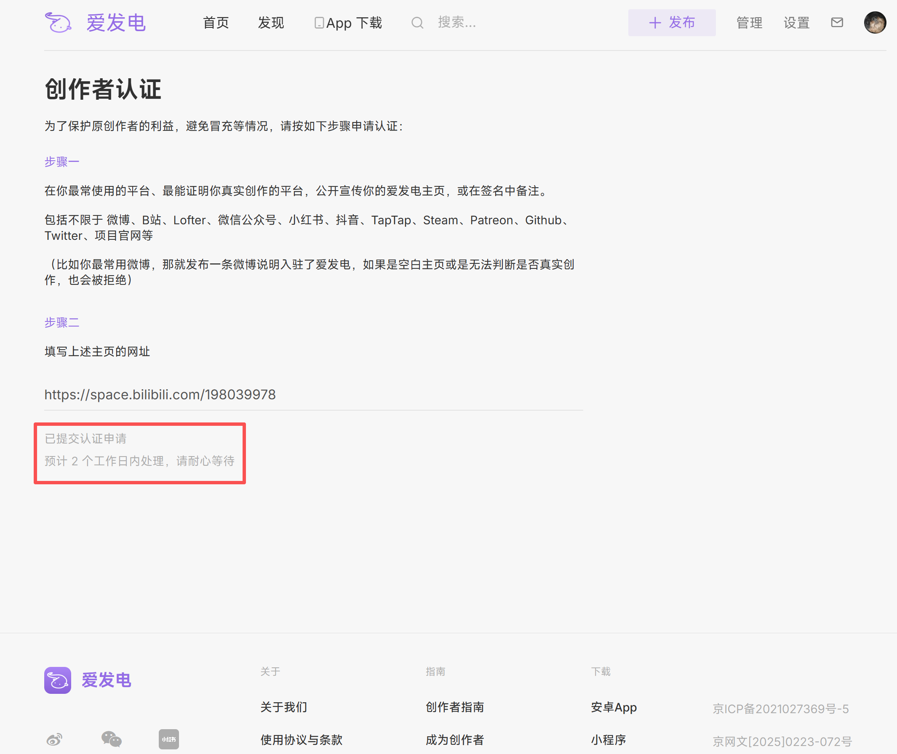

# ClinwriteXY Lite

面向临床论文单段写作的开源 Skill。它帮助修改中英文摘要、结果、讨论、局限性和
结论，同时检查数字、分母、限定词与结论强度有没有被改坏。

> 把医学文字改得自然，同时守住证据边界。

- **版本：** `0.2.0`
- **许可：** MIT
- **默认范围：** 中文段落不超过 800 字，英文段落不超过 500 words
- **在线实验页：**
  [ClinwriteXY 模型对比实验](https://dietcokeeverydaydrinker.github.io/ClinwriteXY-Lite/)

**English:** ClinwriteXY Lite is a small clinical-writing Skill for revising
one Chinese or English abstract, results, discussion, limitation, or conclusion
paragraph. It drafts from supplied facts, calibrates claims to the available
evidence, aligns bilingual abstracts, and checks whether numeric or citation
tokens changed during editing.

## 30 秒试用

把下面这段交给已安装 Lite 的 Agent：

```text
使用 ClinwriteXY Lite 修改下面这段：

模型A的AUC为0.86，可准确预测患者预后并指导临床治疗。研究完成了内部验证，
未做外部验证，也未进行决策影响研究。

要求：保留全部数字和验证层级，不要新增引用或结果。
```

合理的结果会保留 `0.86`、`内部验证` 和 `未做外部验证`，把“准确预测”和
“指导临床治疗”收回到当前证据能够支持的范围，并指出校准、外部验证和临床效用
仍然缺少依据。

## 适合的任务

- 从作者已经提供的分析结果起草一段正文；
- 修改一段中文或英文临床论文文字；
- 检查一段话的结论是否超过现有证据；
- 对齐中英文摘要中的人群、样本量、终点、效应方向和结论强度；
- 检查修改前后数字与常见引用标记是否被增删。

它适合正在写临床 SCI 或学位论文段落的硕博研究生，也适合需要在交给导师、统计师
或润色机构前先做一次证据边界检查的作者。

## 核心做法

Lite 把四项检查放进同一条写作流程：

1. **先冻结证据**：确认研究设计、分母、效应量、验证层级和结论类型；
2. **再做中文微编辑**：处理名词堆叠、长定语、空泛评价、机械转折和翻译腔；
3. **校准结论语言**：把关联、预测、诊断、机制和临床效用分开处理；
4. **执行保真检查**：用脚本发现修改前后数字和常见引用标记的增删。

通用写作工具通常能改善句子，却容易忽略临床论文里的高风险变化：

- 把关联写成因果；
- 把内部验证写成外部验证；
- 把 AUC 写成临床获益；
- 把统计显著写成临床重要；
- 改写时丢失分母、置信区间或限定词；
- 中英文摘要的人群、终点或结论强度不一致。

Lite 选择了一个更窄的工作面：集中处理单个高风险段落，让语言修改、证据边界和
机械保真检查同时发生。

## 能力边界

Lite 可以做：

- 根据作者提供的少量结果写一段正文；
- 在保留关键事实的前提下改善中文或英文表达；
- 判断一段话是否把证据说得过满；
- 对齐中英文摘要的关键口径；
- 用脚本检查数字和常见引用标记是否被增删。

Lite 不负责：

- 搜索实时文献或核验 DOI 是否存在；
- 重新运行统计分析；
- 审阅整篇学位论文或完整投稿包；
- 处理 Word 修订、批注、目录、页码和复杂排版；
- 生成成品 PPT；
- 恢复长期项目状态；
- 代替作者、导师、统计师、伦理委员会或期刊审稿人。

需要文献检索、文献管理、Word 修订、科研绘图或完整论文流程时，应另外安装对应
工具，与 Lite 按需组合。

## 项目缘起

ClinwriteXY 来自真实的临床科研工作。过去半年，作者把论文写作、返修、审稿回复、
数据核对和项目复盘持续沉淀进个人知识库，再从约数百页中英文材料中抽取可复用规则。

使用过程中逐渐发现两类任务需要不同重量的工具：单段写作可以依靠一套紧凑流程完成；
整篇论文还需要项目记忆、跨文件核对和完整返修记录。于是项目拆成开源 Lite 与买断
完整版。Lite 独立完成单段任务，不依赖完整版提示词。

## 效果证据

2026-11-13 使用 5 个基础写作病例和 3 个高阶综合病例，对比 DeepSeek V4 Pro、
V4 Flash 分别搭配 Raw、ClinwriteXY Lite 和 ClinwriteXY Full 的表现。

5 个基础病例的盲评结果：

| 条件 | 盲评均值 |
|---|---:|
| Flash Raw | 109.5 / 125 |
| **Flash + Lite** | **122.5 / 125** |
| Flash + Full | 122.5 / 125 |
| Pro Raw | 118.0 / 125 |
| Pro Lite | 119.0 / 125 |
| Pro Full | 119.5 / 125 |

Flash + Lite 和 Flash + Full 保留了关键病例中的 `1,702` 和 `851` 两个队列样本量，
Pro 三种条件和 Flash Raw 均遗漏。本轮短篇写作证据支持：

> 使用 V4 Flash + ClinwriteXY Lite，以更低成本达到接近或略高于 V4 Pro Raw
> 的盲评水平。

这个结论只适用于本轮脱敏短篇写作病例，不能外推到所有论文、真实投稿或所有临床
亚专科。完整评分锚点见
[模型对比实验](docs/model-comparison-20261113/README.md)。8 个病例的原始输入和
六种组合的 12 份完整文字输出见
[原始输入与六组输出索引](docs/RAW-DATA-INDEX.md)。


## 安装

**不要直接把整个 GitHub 仓库装进 Agent。** 仓库中的 `docs/` 是公开评测证据，
包含 Full 条件的模型生成答案和图片，不属于 Lite 安装包。

从 [Releases](https://github.com/DietCokeEverydayDrinker/ClinwriteXY-Lite/releases)
下载 `ClinwriteXY-Lite-0.2.0-minimal.zip`。解压后应得到一个
`clinwritexy-lite/` 文件夹，其第一层包含 `SKILL.md`。

### Codex

把解压后的 `clinwritexy-lite` 文件夹整体放入：

```text
%USERPROFILE%\.codex\skills\clinwritexy-lite
```

macOS 或 Linux 通常放入：

```text
~/.codex/skills/clinwritexy-lite
```

重启或新开 Codex 会话，然后直接说明任务，或显式调用：

```text
Use $clinwritexy-lite to revise this clinical results paragraph.
```

### Claude Code 或其他 SKILL.md 宿主

把整个目录放入宿主约定的 skills 目录。也可以把目录附加给 Agent，并要求它先读取
`SKILL.md`。不要只复制 `SKILL.md`，因为语言规则、证据边界和摘要对齐规则位于
`references/`。

从源码手动安装时，只需要：

```text
SKILL.md
VERSION
LICENSE
README.md
agents/
references/
scripts/check_preservation.py
scripts/test_check_preservation.py
```

`docs/`、`evaluation/` 和 `evals/` 可以留在仓库中供复核，无需放进 skills 目录。
Codex 可以直接安装；Claude Code、DeepSeek Harness、WorkBuddy 或其他 Agent 的
目录与触发方式，以各自当前文档为准。

安装后先用一段不含患者信息的材料测试。建议新开会话，确认模型确实读取了
`SKILL.md` 和所需 `references/`，再用于真实稿件。

## 保真检查

安装后可运行：

```text
python scripts/check_preservation.py original.txt revised.txt
```

脚本检查数字和常见引用标记是否被增删。它只做机械诊断，不能判断引用是否真的支持
当前句子。发现差异后仍需人工核对上下文。

它也不能自动判断分母是否被换了研究对象、内部验证是否被写成外部验证，或关联是否
被写成因果。这些项目由 Skill 的审阅规则处理，仍需要作者最终确认。

运行内置测试：

```text
python -m unittest discover -s scripts -p "test_*.py"
python scripts/validate_evals.py evals/cases.jsonl
```

## Lite 与完整版的分工

Lite 和完整版面向不同工作量。短段落写作可以直接使用 Lite；整篇论文、跨文件核对
和完整返修再考虑完整版。

| 工作环节 | 开源 Lite | 完整版 ClinwriteXY |
|---|---|---|
| 输入范围 | 一段中文或英文摘要、结果、讨论、结论 | 整篇 SCI 手稿、学位论文、多章综述和完整投稿包 |
| 写作系统 | 单段写作、证据冻结和数字保真 | 从约数百页个人科研知识库中抽象出的六层写作系统：论证、中文表达、英文护栏、章节动作、功能短语、双语等价 |
| 数据到正文 | 根据作者已提供的少量结果写一段 | 结果表、分析集、分母、模型参数和正文之间建立对应关系，并追踪版本 |
| 项目状态 | 每次任务独立处理 | 项目护照、权威文件、数据与结果版本、关键决策、待办和恢复卡 |
| 证据与引用 | 单段论点边界和双语口径检查 | 全篇论点证据表、四层引用完整性、报告规范映射和跨章节结论边界 |
| 复现链 | 机械检查数字、分母和常见引用标记 | 追踪结论、表、图、脚本、参数、数据版本和正文之间是否断链 |
| 返修 | 不覆盖完整返修流程 | 学位论文与投稿审阅、审稿意见逐条回复、真实修改位置映射和返修台账 |
| 汇报 | 不生成页面方案 | 按论证给出逐页目标、图表选择、文字示意和 speaker note |
| 协作成长 | 固定规则，不保存项目状态 | 可选协作偏好；新经验先进入本地候选，经用户确认后才可能形成工作包 |

完整版最核心的增量集中在写作与语言润色。它把中英文论文和学位论文中的论证顺序、
章节接口、中文去模板化、英文时态与动词强度、功能短语、限定词、引用口径和双语等价
拆成可调用规则，覆盖摘要、引言、方法、结果、讨论、结论、局限性和审稿回复等场景。
这些规则来自长期真实科研写作和反复修改，细化到段落动作、句子功能和常见误改边界。

完整版的覆盖范围更大，不承诺把同一段文字再提高固定分数。本轮 5 个脱敏基础写作
病例中，Lite 与 Full 同为 `122.5/125`。完整版的价值主要在短篇分数没有覆盖的
整篇论文、多文件核对、项目恢复和完整返修。实际效果取决于输入材料、模型和人工复核。

需要整篇论文、多文献证据综合、跨文件结果核对、审稿回复或长期项目记录时，再使用
完整版。完整版当前价格为 9.9 元，一次性买断，不包含固定频率更新、定制安装、
一对一论文修改或无限期维护。源码不公开，Lite 的 MIT 许可是独立授权。

### 完整版当前状态

爱发电创作者认证仍在审核中。后台仍显示“已提交认证申请”，目前已经超过页面提示的
预计处理时间，具体商品页暂时无法查看。



**目前如何购买：** 完整版暂不要通过爱发电下单。请前往
[小红书主页：无糖可乐每日饮](https://www.xiaohongshu.com/user/profile/69666bf30000000003012a27)，
查看置顶笔记中的购买链接。

这几天已有一百多人次点进爱发电主页，却因为认证尚未完成看不到商品，实在抱歉让
大家白跑一趟。认证通过后，我会尽快把正式购买入口补到这里。也可以继续关注：

- [Bilibili：无糖可乐每日饮](https://space.bilibili.com/198039978)

价格、当前交付版本和售后范围以商品页说明为准。

## 使用反馈

试过 Lite 后，可以在 Discussions 留下真实记录：

- [使用反馈](https://github.com/DietCokeEverydayDrinker/ClinwriteXY-Lite/discussions/categories/show-and-tell)：
  写清 Agent、模型、任务类型、实际效果和仍然不足的地方；
- [问题报告](https://github.com/DietCokeEverydayDrinker/ClinwriteXY-Lite/discussions/categories/q-a)：
  安装失败、脚本报错或输出异常时，提供版本、复现步骤和脱敏报错信息；
- [功能建议](https://github.com/DietCokeEverydayDrinker/ClinwriteXY-Lite/discussions/categories/ideas)：
  说明现有流程解决不了什么问题，以及希望 Lite 增加哪种能力。

反馈只使用合成、公开或充分脱敏的材料。不要粘贴患者信息、账号凭据、未发表稿件
或受限原始数据。GitHub Star 只表示收藏，不表示评分；真正使用后再 Star 即可。

## 隐私

不要提交患者姓名、住院号、影像、联系方式、医院内部账号、未脱敏原始数据或受限
机构文件。使用云端模型时，材料会受所用 Agent 和模型服务的数据政策约束。公开示例
应保持合成内容。

真实稿件应先脱敏，并遵守所用 Agent、模型服务和机构的数据政策。Lite 不提供患者
诊疗建议，也不替代导师、统计师、伦理委员会或期刊审稿人。

## 免责声明

ClinwriteXY 提供科研写作、证据整理和信息核查辅助，不构成医疗诊断、治疗建议或
研究伦理审查意见。AI 输出可能出现遗漏、误读、错误引用或事实幻觉，使用者必须
核对原始数据、统计分析、文献全文、引用关系和所属机构要求，并对最终稿件负责。

Lite 与完整版均不承诺论文录用、盲审通过、查重结果或 AI 检测结果。第三方 Agent、
模型、API、文献检索和文献管理服务受各自条款与数据政策约束。

## License

本仓库使用 MIT License。完整版 ClinwriteXY 使用独立的购买者授权，不因 Lite 开源
而改变。
