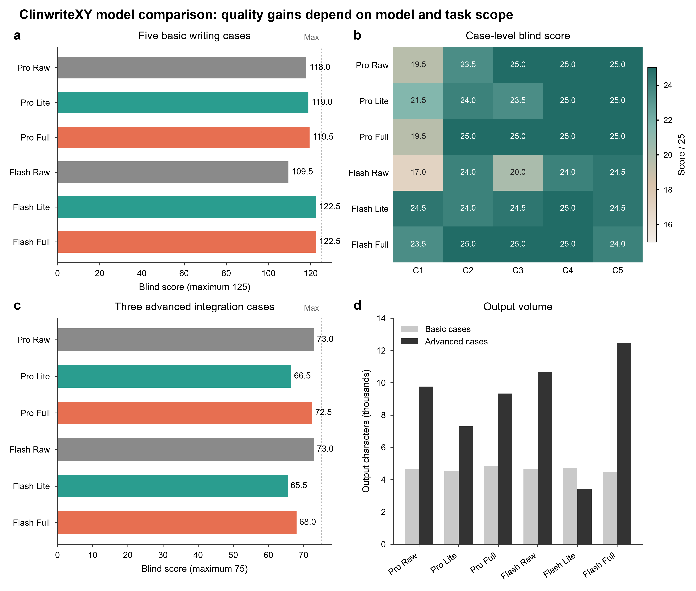
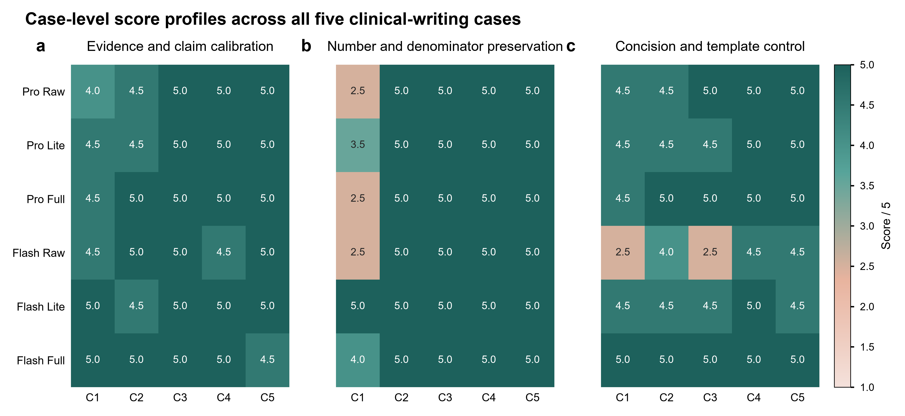

# ClinwriteXY 模型对比测试报告

日期：2026-11-13

版本：ClinwriteXY 1.0.0、ClinwriteXY Lite 当次测试版

测试模型：DeepSeek V4 Pro、DeepSeek V4 Flash

**图 1。六个测试条件的总体表现。** a，5 个基础写作病例的盲评总分；b，逐病例
盲评分数；c，3 个高阶综合病例的盲评总分；d，基础和高阶任务的全部输出字符数。
灰色为 Raw，绿色为 Lite，橙色为 Full。图中的分数是两位模型评审的均值。

**图 2。五个基础病例的逐例评分结构。** a，证据与结论校准；b，数字、分母和
验证层级保真；c，简洁度与模板腔控制。每列对应一个病例，每行对应一个测试条件。
病例 1 是保真差异最明显的病例，病例 2–5 在多数条件下接近满分。颜色只表示评分
高低，不表示临床风险。

## 结论摘要

本轮测试已经完成。每组模型分别运行裸模、Lite、Full 三种条件，共 6 个测试组；
基础写作 5 例，高阶综合 3 例，全部保留原始输出、盲评映射、逐例分数和确定性检查。

核心结论如下：

1. **Flash 用户获得的稳定性提升最明显。** 5 个基础病例中，Flash 裸模平均
   `109.5/125`，Flash + Lite 和 Flash + Full 均为 `122.5/125`。主要差异来自
   队列样本量、分母、验证层级和结论强度是否被完整保留。
2. **Pro 用户不能期待 Skill 自动带来明显的单段写作加分。** Pro 裸模平均
   `118.0/125`，Pro + Lite 为 `119.0/125`，Pro + Full 为 `119.5/125`。
   三种 Pro 条件都漏掉了同一病例中的 `1,702` 和 `851` 两个队列样本量。
3. **高阶任务中，Full 的价值集中在流程覆盖。** 3 个高阶病例中，
   Pro 裸模和 Flash 裸模平均均为 `73.0/75`，Pro + Full 为 `72.5/75`。
   Full 更容易给出完整审计字段、跨文件对账、可执行检索交接和逐页汇报骨架；
   在短而明确的单项请求里，裸模已经具备较强能力。
4. **Lite 的产品定位成立，但只适合短篇写作与单段核查。** Lite 在基础病例中
   表现稳定，尤其适合 Flash 用户；遇到整章审阅、完整审稿回复、跨文件审计或
   成品 PPTX 请求时，它会主动收窄范围。这个限制会降低高阶任务得分，同时符合
   Lite 的产品边界。
5. **当前证据不支持“Full 在任何提示下都优于裸模”。** 更准确的表述是：
   Full 提高了流程约束、证据口径一致性、审计覆盖和交付结构；它对较强裸模的
   单段语言质量没有稳定增益。
6. **Flash + Lite 的性价比在本轮基础写作中得到支持。** 5 个基础病例中，
   Flash + Lite 与 Flash + Full 同为 `122.5/125`，比 Pro Raw 的
   `118.0/125` 高 `4.5` 分。该结论只适用于本轮短篇写作场景，不能外推到
   整篇论文、真实投稿或所有临床亚专科。

本报告是合成材料上的内部模型对比，不是临床有效性研究，也不能证明论文接收率、
盲审通过率或 AI 检测率会发生变化。

### 最值得公开的产品结论

可以把本轮结果概括为：

> 在 5 个脱敏临床写作病例中，V4 Flash 接入 ClinwriteXY Lite 或 Full 后，
> 盲评总分从 `109.5/125` 提升到 `122.5/125`，达到与本轮 V4 Pro Raw
> `118.0/125` 相同或略高的水平；同时，Flash + Lite 和 Flash + Full 保住了
> Pro 三种条件都遗漏的 `1,702` 与 `851` 两个队列样本量。Lite 适合短篇写作，
> Full 适合整篇论文和跨文件工作流。

这组证据支持“用 Flash + Lite 以更低成本达到接近或超过 Pro 基础写作水平”的
产品方向，不能支持“Lite 在所有任务上等于或优于 Pro”。高阶病例中，Pro Raw
和 Flash Raw 均为 `73.0/75`，完整工作流仍需要 Full 或专门的外部工具。

## 测试方法

### 基础写作病例

使用
`clinwritexy-lite/evaluation/test-cases.md`
中的 5 个脱敏病例，覆盖：

- 英文模型验证与临床效用讨论；
- 英文观察性关联与中介分析讨论；
- 小型单中心诊断准确性研究；
- 中文临床摘要去模板化与结论降调；
- 中英文摘要的数字、分母、终点和结论强度对齐。

三个条件收到完全相同的病例文本、任务要求和输出格式约束：

- `Raw`：不得读取 ClinwriteXY 文件；
- `Lite`：只能读取 `clinwritexy-lite/SKILL.md` 及其按需引用；
- `Full`：只能读取 `clinwritexy/SKILL.md` 及其按需引用。

所有条件均禁止联网检索、调用其他写作 Skill 或引入外部材料。

第一轮基础病例曾使用继承上下文的执行方式，可能带入此前对话和 Skill 信息，因此
只作为预实验保留。正式结果使用完全隔离的新执行环境重跑，文件位于 `raw-clean`。

### 高阶综合病例

使用 `ADVANCED-CASES.md` 中的 3 个合成病例：

- 跨摘要、结果表、讨论和审稿意见的结果审计与审稿回复；
- 学位论文研究问题、结果、章节接口、表格、图和结论边界审阅；
- 多研究综述、联网检索交接和逐页 PPT 汇报设计。

高阶测试从一开始使用隔离环境，没有沿用基础病例的会话上下文。

### 脱敏材料清单

本报告所称“脱敏材料”是公开病例摘要、开放获取论文的事实摘要，以及不包含真实
患者、机构或用户课题的合成项目快照。没有使用真实病历、真实研究数据、医院文件
或未公开论文。

| 文件 | 内容 | 公开使用说明 |
|---|---|---|
| [BASIC-CASES.md](model-comparison-20261113/cases/BASIC-CASES.md) | 病例 1–5 的原始事实、任务和输出要求 | 病例 1–3 来自开放获取文献摘要；病例 4–5 使用同一组已公开事实，所有患者标识均已去除 |
| [ADVANCED-CASES.md](model-comparison-20261113/cases/ADVANCED-CASES.md) | 病例 6–8 的跨文件、学位论文和多研究综合材料 | 完全合成的项目快照，没有真实患者或机构信息 |
| [EXPECTED-CHECKS.md](model-comparison-20261113/EXPECTED-CHECKS.md) | 基础病例的核对点 | 不作为生成模型的输入 |
| [ADVANCED-EXPECTED.md](model-comparison-20261113/ADVANCED-EXPECTED.md) | 高阶病例的核对点 | 不作为生成模型的输入 |

病例 1–3 的精确原文和任务要求见 `BASIC-CASES.md`。病例 4–5 的完整中文事实和
英文摘要对齐任务也在同一文件。病例 6–8 的精确项目快照和用户请求见
`ADVANCED-CASES.md`。报告正文只摘录差异点；完整版本以这些文件为准。

### 评分

每个基础病例按 5 个维度评分，每项 1 至 5 分，满分 25 分：

- 证据与结论校准；
- 数字、分母、终点和验证标签保真；
- 请求语言下的临床学术表达；
- 简洁度与模板腔控制；
- 独立可用性。

高阶病例按以下维度评分：

- 证据；
- 一致性；
- 完整性；
- 可执行性；
- 简洁度。

评分采用隐藏条件名称的盲评。两位模型评审分别评分，报告展示两者均值和分歧。
模型评审不是人类同行评审，分数用于发现差异和失败模式，不能当作学术质量量表。

### 1–5 分评分锚点

为了让评分可以复核，基础和高阶维度使用下面这组统一的 1–5 分锚点。原始评审
JSON 保留了每例的维度分和材料错误记录。

| 维度 | 1 分 | 3 分 | 5 分 |
|---|---|---|---|
| 基础：证据与结论校准 | 编造证据，或结论与来源明显冲突 | 有一处会改变解释方向的过度声明 | 所有结论都落在来源支持范围内，限定词准确 |
| 基础：数字与口径保真 | 改错核心数字、分母或验证层级 | 漏掉一个会影响解释的关键数字或终点 | 样本量、分母、CI、单位和验证标签完整保留 |
| 基础：临床学术表达 | 语言不可用，术语或时态造成误读 | 可读懂，但有明显模板腔、搭配或段落衔接问题 | 可直接进入论文的清晰临床学术表达 |
| 基础：简洁度与模板腔控制 | 大量重复、空泛总结或固定套话 | 有可删的重复和泛化段落 | 信息密度高，没有无关审计或空泛结尾 |
| 基础：独立可用性 | 需要重新完成主要工作 | 主体可用，但仍需明显人工修复 | 可以直接交给导师、作者或期刊前审阅 |
| 高阶：证据 | 引入未提供的证据或结论 | 主要证据边界正确，但有遗漏 | 明确区分来源、推断和缺失材料 |
| 高阶：一致性 | 文件之间的冲突未处理或处理错误 | 找到主要冲突，仍有少量接口未对齐 | 跨文件数字、表号、图号和结论完全对账 |
| 高阶：完整性 | 缺少关键交付物 | 覆盖大部分任务，但有明确遗漏 | 请求的交付物和边界说明都完整 |
| 高阶：可执行性 | 只指出问题，没有可操作下一步 | 有下一步，但需要用户重新设计流程 | 可直接执行的对账、修改或交接步骤 |
| 高阶：简洁度 | 篇幅失控，结构妨碍阅读 | 信息正确但存在重复或表格膨胀 | 结构紧凑，信息可快速扫描 |

评分流程如下：

1. 每个病例先按 1–5 分逐维度评分；
2. 同一病例的五个维度相加，得到该病例的 `25` 分制总分；
3. 5 个基础病例总分相加，得到 `125` 分制；3 个高阶病例相加，得到
   `75` 分制；
4. 两位盲评分别评分，报告使用两位评审的算术平均值；
5. 明确数字缺失、编造引用、未执行分析被写成已完成等硬错误，会在
   `material_errors` 中单独记录，不能靠语言分抵消。

本轮盲评使用两组隐藏映射：

- 基础：`A=Pro Full, B=Flash Lite, C=Pro Raw, D=Flash Full,
  E=Pro Lite, F=Flash Raw`；
- 高阶：`G=Pro Raw, H=Pro Lite, I=Pro Full, J=Flash Raw,
  K=Flash Lite, L=Flash Full`。

原始映射和评分 JSON 位于
[scores](model-comparison-20261113/scores)。

## 基础病例结果

| 条件 | 盲评均值 | Pro 评审 | Flash 评审 |
|---|---:|---:|---:|
| Flash + Lite | 122.5 / 125 | 122 | 123 |
| Flash + Full | 122.5 / 125 | 125 | 120 |
| Pro + Full | 119.5 / 125 | 117 | 122 |
| Pro + Lite | 119.0 / 125 | 114 | 124 |
| Pro Raw | 118.0 / 125 | 116 | 120 |
| Flash Raw | 109.5 / 125 | 108 | 111 |

逐例盲评均值如下：

| 条件 | 病例 1 | 病例 2 | 病例 3 | 病例 4 | 病例 5 |
|---|---:|---:|---:|---:|---:|
| Pro Raw | 19.5 | 23.5 | 25.0 | 25.0 | 25.0 |
| Pro + Lite | 21.5 | 24.0 | 23.5 | 25.0 | 25.0 |
| Pro + Full | 19.5 | 25.0 | 25.0 | 25.0 | 25.0 |
| Flash Raw | 17.0 | 24.0 | 20.0 | 24.0 | 24.5 |
| Flash + Lite | 24.5 | 24.0 | 24.5 | 25.0 | 24.5 |
| Flash + Full | 23.5 | 25.0 | 25.0 | 25.0 | 24.0 |

### 主要发现

病例 1 是本轮最有区分度的病例。任务明确要求保留 `1,702` 名瑞士开发/内部验证
患者和 `851` 名英国外部验证患者。Flash + Lite 与 Flash + Full 保留了这两个
数字；Pro 的三种条件全部遗漏。Flash Raw 也遗漏了这两个数字，并额外漏掉病例 2
对残余混杂的明确限定。

病例 2、4、5 的整体完成度较高。多数条件都保留了效应量、置信区间、分母、
结局指标和观察性研究限制。主要剩余问题包括：

- 把 `metabolic signature` 改写成 `metabolic disturbances`；
- 把中介比例写成略显确定的过程；
- 在中文修改中增加“多数患者可获得初始缓解”等未直接提供的解释；
- 在有限篇幅内优先写概括，挤掉应保留的分母或终点。

病例 3 的主要问题是小样本、单中心和回顾性设计的不确定性表达。多数输出在语义上
合格，但部分条件使用较泛化的 `small sample` 说明，或把结论句并入正文，导致格式
要求与信息密度略有损失。

### 代表性差异：病例 1

输入事实明确给出：

- `1,702` 名瑞士患者，用于模型开发和内部验证；
- `851` 名英国患者，用于外部验证；
- 内部 AUC `0.72`（95% CI `0.63–0.81`）；
- 外部 AUC `0.64`（95% CI `0.58–0.70`）；
- 摘要没有报告决策曲线、工作流影响或随机临床效用研究。

Pro Raw 的开头是：

> In the development cohort, the model achieved an internal-validation AUC of
> 0.72 (95% CI 0.63 to 0.81)...

这段文字保留了 AUC 和验证层级，但没有写出 `1,702` 和 `851`。Pro Lite 和
Pro Full 的正式输出也遗漏了这两个样本量。

Flash Raw 同样以 `development cohort` 开头，没有写出两个队列规模。Flash Lite
则直接写出：

> Among 1,702 patients in Switzerland, the model showed discrimination during
> development and internal validation... In 851 patients in the UK, external
> validation showed lower discrimination...

Flash Full 也保留了这两个数字，并把内部验证与外部验证分开陈述。该差异直接导致
病例 1 的保真维度发生 2.5–3.5 分与 4–5 分档位的分离。完整输出见
[basic/flash-lite.md](model-comparison-20261113/outputs/basic/flash-lite.md)、
[basic/flash-full.md](model-comparison-20261113/outputs/basic/flash-full.md)
和 [basic/pro-raw.md](model-comparison-20261113/outputs/basic/pro-raw.md)。

### 代表性差异：病例 8

病例 8 要求从三篇研究写综述，再找五篇文献并生成 10 页 PPT。所有条件都没有
伪造文献或声称生成 PPTX。Flash Lite 明确把检索和成品 PPT 交给外部工具，但页面
级汇报骨架较少；Pro Full 和 Flash Full 给出更完整的检索字段、页面设计和交接
结构，同时输出明显更长。这个病例说明 Full 的优势是功能覆盖和交接完整度，单段
文字质量不能单独解释全部得分。

### 全部输出索引

以下文件是六个条件在全部病例上的完整输出，未做二次人工改写。点击文件名可以查看
原始 Markdown：

| 条件 | 基础 5 例 | 高阶 3 例 |
|---|---|---|
| Pro Raw | [pro-raw.md](model-comparison-20261113/outputs/basic/pro-raw.md) | [pro-raw-advanced.md](model-comparison-20261113/outputs/advanced/pro-raw-advanced.md) |
| Pro Lite | [pro-lite.md](model-comparison-20261113/outputs/basic/pro-lite.md) | [pro-lite-advanced.md](model-comparison-20261113/outputs/advanced/pro-lite-advanced.md) |
| Pro Full | [pro-full.md](model-comparison-20261113/outputs/basic/pro-full.md) | [pro-full-advanced.md](model-comparison-20261113/outputs/advanced/pro-full-advanced.md) |
| Flash Raw | [flash-raw.md](model-comparison-20261113/outputs/basic/flash-raw.md) | [flash-raw-advanced.md](model-comparison-20261113/outputs/advanced/flash-raw-advanced.md) |
| Flash Lite | [flash-lite.md](model-comparison-20261113/outputs/basic/flash-lite.md) | [flash-lite-advanced.md](model-comparison-20261113/outputs/advanced/flash-lite-advanced.md) |
| Flash Full | [flash-full.md](model-comparison-20261113/outputs/basic/flash-full.md) | [flash-full-advanced.md](model-comparison-20261113/outputs/advanced/flash-full-advanced.md) |

### 确定性检查

字符串检查与语义盲评存在少量分歧，原因是同一个概念可能被改写为不同表达。确定性
检查仍能稳定发现明确数字缺失：

- Pro Raw、Pro + Lite、Pro + Full：病例 1 缺 `1,702` 和 `851`；
- Flash Raw：病例 1 缺 `1,702` 和 `851`；
- Flash + Lite、Flash + Full：两个样本量均存在。

因此，“Flash 条件下 Skill 明显改善了关键数字保真”有直接文本证据支持。
Pro 条件下本轮没有观察到同类改善。确定性检查还发现，Pro + Lite 和 Pro + Full
在病例 5 中没有写出精确字符串 `20/30`，但正文保留了队列总数 `30` 和女性
`66.7%`，语义盲评因此没有把它判为材料缺失。这类差异说明字符串检查适合发现漏项，
最终仍需要结合上下文判断。

## 高阶病例结果

| 条件 | 盲评均值 | Pro 评审 | Flash 评审 |
|---|---:|---:|---:|
| Pro Raw | 73.0 / 75 | 73 | 73 |
| Flash Raw | 73.0 / 75 | 72 | 74 |
| Pro + Full | 72.5 / 75 | 73 | 72 |
| Flash + Full | 68.0 / 75 | 70 | 66 |
| Pro + Lite | 66.5 / 75 | 66 | 67 |
| Flash + Lite | 65.5 / 75 | 65 | 66 |

逐例盲评均值如下：

| 条件 | 病例 6 | 病例 7 | 病例 8 |
|---|---:|---:|---:|
| Pro Raw | 24.5 | 24.5 | 24.0 |
| Pro + Lite | 21.0 | 22.5 | 23.0 |
| Pro + Full | 24.5 | 24.0 | 24.0 |
| Flash Raw | 24.5 | 24.5 | 24.0 |
| Flash + Lite | 22.0 | 22.5 | 21.0 |
| Flash + Full | 23.0 | 22.5 | 22.5 |

### 病例 6：跨文件结果审计与审稿回复

六组条件都没有编造已完成的分析或 E-value。Pro Raw、Pro + Full、Flash Raw
和 Flash + Full 能识别主要不一致，并给出审稿回复和下一步动作。Lite 明确表示
完整审稿回复超出范围，完整性因此下降。

Pro + Full 的对账表和证据表便于核查，但篇幅较长。Flash + Full 信息覆盖充分，
简洁度略逊于裸模。该病例支持 Full 的流程价值，也说明对明确要求的跨文件校对，
较强的裸模已经能完成大部分工作。

### 病例 7：学位论文章节接口

主要问题包括 `88/86/90` 参与者不一致、研究问题与生存分析错位、生存获益和治疗
推荐越界、`Table 3.4/Table 3.3` 引用不一致，以及缺失图件。多数条件都能识别
这些冲突并拒绝补造图件。

差异主要在于是否明确指出结果部分缺少主要关联效应量和置信区间。Pro + Full
给出了更完整的逐节修复结构；部分裸模输出也存在漏掉这个阻塞项的情况。

### 病例 8：多研究综述、检索和汇报交接

所有条件都区分了随机试验、动物实验和观察性证据，没有从动物结果推导临床获益，
也没有编造五篇文献或声称生成真实 PPTX。

Full 更容易提供可审计检索字段和逐页汇报骨架。Lite 因产品范围限制，主要给出
缺失输入和外部工具交接，逐页设计不足。该结果符合“Lite 负责单段写作，Full
负责完整工作流”的分工。

## 输出规模与上下文成本

下表统计各条件 5 个基础病例或 3 个高阶病例的全部输出字符数，用来观察交付体量。
字符数不能直接等同 API token，也没有包含 Skill 文件和引用文件带来的输入 token。

| 条件 | 基础 5 例字符数 | 高阶 3 例字符数 |
|---|---:|---:|
| Pro Raw | 4,647 | 9,763 |
| Pro + Lite | 4,523 | 7,295 |
| Pro + Full | 4,825 | 9,334 |
| Flash Raw | 4,676 | 10,650 |
| Flash + Lite | 4,716 | 3,423 |
| Flash + Full | 4,462 | 12,484 |

基础写作中，六组输出体量接近，主要成本差异来自加载 Skill 文件，不来自输出长度。
高阶任务中，Flash + Full 的输出明显最长，主要因为补充了对账表、审计字段和交接
结构；Lite 的输出最短，因为它主动把完整审稿回复、整章审计和 PPT 设计交回外部
流程。

这组数据支持两条成本判断：

- 短篇写作优先使用 Lite，可以减少无关引用和固定审计段落；
- 高阶任务只在确实需要跨文件对账、完整交接或审计留痕时使用 Full。

本轮没有记录精确 token 数、首字延迟和总耗时，不能据此计算单例价格。用户侧记录
到当晚 Pro 测试产生约 `¥5.69` 的账户消费；这笔费用不能拆分到每个病例，也不能
直接推断 Flash 的精确费用。结合本轮结果，Flash + Lite 是短篇写作的低成本候选，
Full 的附加成本主要出现在高阶任务的输入文件和较长输出上。

## 产品判断

### Flash

本轮结果支持推荐 Flash 用户使用 Lite 或 Full。两类 Skill 条件都在关键数字保真、
验证层级和结论强度方面带来明显改善。对只需要摘要、结果、讨论或结论单段写作的
用户，Lite 的性价比更高；需要项目状态、跨文件审计、审稿回复和完整交接时，再使用
Full。

### Pro

本轮结果不支持“Pro 接入 Skill 后每一段文字都会更好”。Pro 裸模在 8 个合成病例
中已经能完成大量任务。Full 的合理卖点是工作流约束、审计结构、跨文件对账和交付
边界；单段写作增益需要更多病例验证。Pro 的账户成本明显高于 Flash，若用户的主要
任务是摘要、结果、讨论或结论的单段写作，本轮证据更支持先使用 Flash + Lite。

### Lite 与 Full 的梯度

基础写作中，Lite 与 Full 均能稳定保真，Flash 条件下得分相同。高阶任务中，Full
覆盖范围更广，但默认输出也更长。当前梯度清晰：

- Lite：短篇、单段、摘要对齐、快速保真检查；
- Full：整篇、跨文件、项目恢复、审稿回复、证据审计和外部工具交接。

Full 的功能范围覆盖整篇流程，Lite 从设计上只覆盖单段高风险文本。功能范围有
包含关系，分数没有包含关系：在有限提示和单段任务中，Lite 可能因为更短、更聚焦
而拿到不低于 Full 的分数；在整篇、跨文件和完整交接任务中，Full 才会显示出更
完整的覆盖。Full 需要进一步压缩默认输出。对短请求加载完整审计模板，会降低
可读性并浪费上下文。

## 已确认的优化候选

以下问题来自本轮实证，尚未自动修改正式规则：

1. **用户指定格式优先。** 当用户要求固定段数、字数或“只给修改稿”时，不应额外
   追加固定的 `保真记录`、审计表或多个总结段。
2. **字数受限时优先保留硬信息。** 先写样本量、分母、效应量、CI、验证标签和
   主要终点，再补充一般性解释。
3. **Full 默认更短。** 大型审计表只在真实跨文件、整篇审阅或用户明确要求时输出。
4. **显式检查主要效应量缺失。** 对“关联研究”结果章，应把缺少主要效应量和
   置信区间列为阻塞项。
5. **加强缺数保护。** 在段长压缩、中文改写和双语对齐时，把样本量、事件数、
   分析集分母列为最高优先级不可删信息。
6. **Lite 的高阶交接保持克制。** Lite 可以给最小可执行交接，不应为了高阶得分
   扩张成完整审计工具，否则会破坏轻量定位。

这些改动适合在下一轮累计更新时一起实施，并在修改后重跑本报告中的病例 1、3、6
和 8。

## 局限

- 只有 8 个合成病例，不能代表所有临床亚专科和论文类型；
- 两位评审均为模型，不是临床专家或期刊编辑；
- 盲评能降低标签偏差，不能消除模型评审偏好；
- 基础病例和部分高阶请求带有明确格式约束，可能削弱 Skill 的开放式增益；
- 没有真实用户盲测、退款率、长期使用、投稿结果或答辩结果；
- 没有记录精确 token 数、逐例 API 费用和端到端耗时；
- DeepSeek 模型版本和行为可能随服务端更新变化；
- 字符串确定性检查无法判断释义是否忠于来源，只能发现明显遗漏。

## 可复现文件

评测根目录：

`docs/model-comparison-20261113`

关键文件：

- `PROTOCOL.md`
- `EXPECTED-CHECKS.md`
- `ADVANCED-CASES.md`
- `ADVANCED-EXPECTED.md`
- `raw-clean/*.md`
- `raw/*-advanced.md`
- `scores/blind-clean-key.json`
- `scores/blind-advanced-key.json`
- `scores/judge-pro-clean.json`
- `scores/judge-flash-clean.json`
- `scores/judge-pro-advanced.json`
- `scores/judge-flash-advanced.json`
- `scores/deterministic-checks-clean.json`
- `docs/model-comparison-20261113/assets/figure-1-overall-performance.png`
- `docs/model-comparison-20261113/assets/figure-1-overall-performance.svg`
- `docs/model-comparison-20261113/assets/figure-1-overall-performance.pdf`
- `docs/model-comparison-20261113/assets/figure-2-evidence-preservation.png`
- `docs/model-comparison-20261113/assets/figure-2-evidence-preservation.svg`
- `docs/model-comparison-20261113/assets/figure-2-evidence-preservation.pdf`

报告内嵌的完整材料、原始输出、评分 JSON、源数据 CSV 和绘图脚本位于
`docs/model-comparison-20261113`。CSV 是图表的直接源数据；PNG 用于网页展示，
SVG 和 PDF 保留可编辑文字，便于后续重排版。

