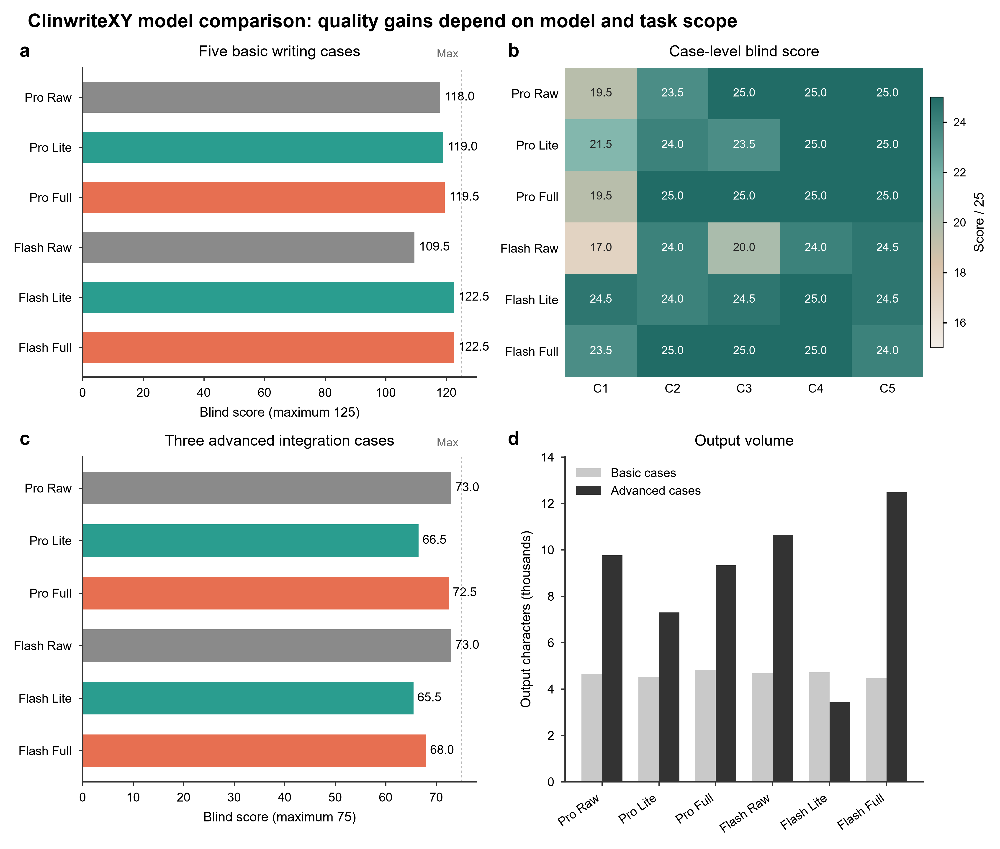
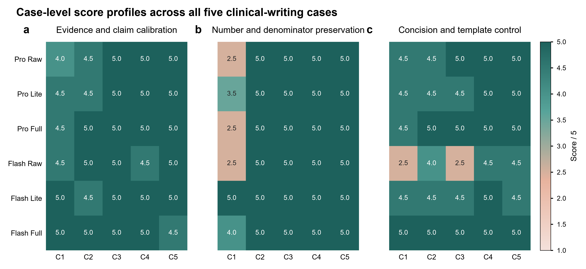

# ClinwriteXY 模型对比实验

日期：2026-11-13

这是 ClinwriteXY 的公开可复核模型对比实验页。测试比较 DeepSeek V4 Pro 和
V4 Flash 在 Raw、ClinwriteXY Lite、ClinwriteXY Full 三种条件下的表现，共
6 个测试组、5 个基础写作病例和 3 个高阶综合病例。

完整方法、逐例分析、评分锚点、产品判断和局限性见
[完整中文报告](../MODEL-COMPARISON-20261113.zh-CN.md)。

## 最重要的结果

- 基础写作：Flash Raw `109.5/125`，Flash + Lite `122.5/125`，
  Flash + Full `122.5/125`；
- 基础写作：Pro Raw `118.0/125`，Pro + Lite `119.0/125`，
  Pro + Full `119.5/125`；
- Flash + Lite 和 Flash + Full 保留了病例 1 的 `1,702` 与 `851` 两个队列
  样本量，Pro 三种条件和 Flash Raw 均遗漏；
- 高阶综合：Pro Raw 和 Flash Raw 均为 `73.0/75`，Pro Full 为
  `72.5/75`；
- Lite 适合短篇写作和单段证据核查，Full 适合整篇论文、跨文件审计、审稿回复
  和完整工作流。

这组证据支持“在脱敏基础写作病例中，Flash + Lite 以更低成本达到接近或略高于
Pro Raw 的盲评水平”。这组证据不支持“Lite 在所有任务上等于或优于 Pro”。

**图 1。** 基础病例、逐病例、高阶病例和输出体量的六组比较。

**图 2。** 五个基础病例的逐例评分结构：证据与结论校准、数字与分母保真、
简洁度与模板腔控制。病例 1 是主要差异来源，病例 2–5 在多数条件下接近满分。

## 完整材料

- [原始输入与六组输出总索引](../RAW-DATA-INDEX.md)
- [基础病例 1–5 原文](cases/BASIC-CASES.md)
- [高阶病例 6–8 原文](cases/ADVANCED-CASES.md)
- [基础病例核对点](EXPECTED-CHECKS.md)
- [高阶病例核对点](ADVANCED-EXPECTED.md)
- [测试方案](PROTOCOL.md)
- [Flash Raw 基础输出](outputs/basic/flash-raw.md)
- [Flash Lite 基础输出](outputs/basic/flash-lite.md)
- [Flash Full 基础输出](outputs/basic/flash-full.md)
- [Pro Raw 基础输出](outputs/basic/pro-raw.md)
- [Pro Lite 基础输出](outputs/basic/pro-lite.md)
- [Pro Full 基础输出](outputs/basic/pro-full.md)
- [Flash Raw 高阶输出](outputs/advanced/flash-raw-advanced.md)
- [Flash Lite 高阶输出](outputs/advanced/flash-lite-advanced.md)
- [Flash Full 高阶输出](outputs/advanced/flash-full-advanced.md)
- [Pro Raw 高阶输出](outputs/advanced/pro-raw-advanced.md)
- [Pro Lite 高阶输出](outputs/advanced/pro-lite-advanced.md)
- [Pro Full 高阶输出](outputs/advanced/pro-full-advanced.md)
- [原始评分和盲评映射](scores)
- [图表源数据](data)
- [评分锚点和完整报告](../MODEL-COMPARISON-20261113.zh-CN.md)

## 评分与复现

每个病例先按五个维度各评 1–5 分，总分 25 分。5 个基础病例合计为 125 分，
3 个高阶病例合计为 75 分。两位模型评审在隐藏测试条件名称后分别评分，页面展示
两位评审的算术平均值。具体锚点、材料错误记录和逐例结果均保留在完整报告及
JSON 原始文件中。

图表由 `make_figures.py` 使用 Python 和 matplotlib 生成，导出 PNG、SVG 和
PDF。直接源数据在 `data/scores.csv` 和 `data/case_scores.csv`。测试材料不含
患者标识、真实病历、医院文件或未公开课题。

## 能力边界

这是一项内部合成评测，不是临床有效性研究，也不是人类同行评审。样本量小、病例
数量有限，不能证明论文接收率、盲审通过率或 AI 检测率会变化。实际效果仍取决于
宿主 Agent、模型版本、输入材料、作者提供的证据和人工复核。

